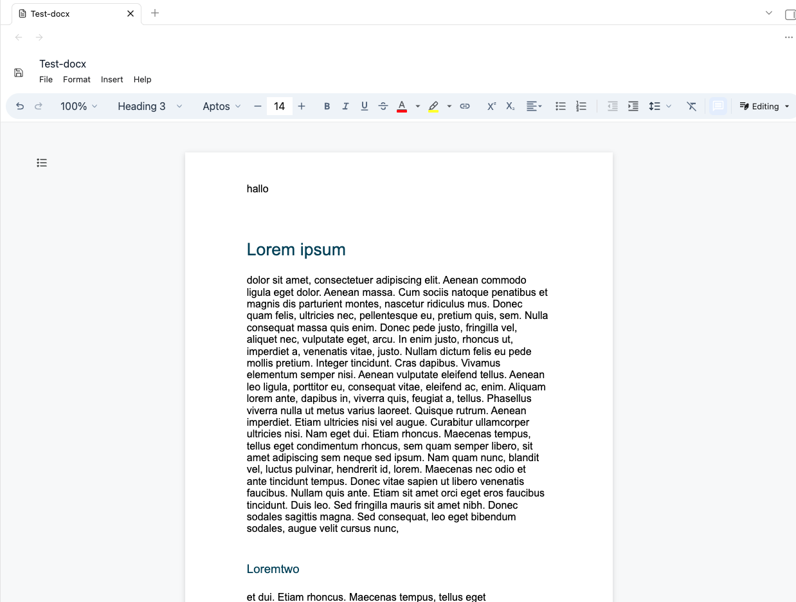

# docxidian

docxidian opens `.docx` files directly inside Obsidian and saves edits back to the same vault file.
You can also embed (read-only) docx-Files via ![[filename.docx]]

The plugin is based on [DOCX EDITOR](https://github.com/eigenpal/docx-editor), and it's Vite/React example.



## Installation

This plugin is not yet part of the Obsidian community plugins. You can install it via BRAT (add this repository's URL as a beta plugin). To install manually, copy `main.js`, `manifest.json`, and `styles.css` from the same release into your vault's plugin folder.

## Usage

Enable the plugin in **Settings -> Community plugins**, then open a `.docx` file from the vault. Obsidian will route it to docxidian's custom file view.

Use the editor toolbar's save action (upper left) or the command **Save current docx** to write changes back to the open file.

You can also embed (read-only) docx-Files via ![[filename.docx]]

## Beta testing

Beta versions are published as GitHub prereleases. Download `main.js`, `manifest.json`, and `styles.css` from the same prerelease and copy all three files into your vault's `.obsidian/plugins/docxidian/` folder, then reload Obsidian. Back up documents you plan to edit during beta testing.

The automated vault integration suite requires a running Obsidian desktop app with its CLI enabled. Run it against the intended test vault:

```sh
OBSIDIAN_TEST_VAULT="Test vault" npm run test:vault
OBSIDIAN_TEST_VAULT="Test vault" npm run test:rulers
```

Set `OBSIDIAN_CLI` if the CLI is installed outside the default macOS app path. The suite creates a new folder containing its own DOCX and Markdown fixtures, restores the editor settings it changes in memory, and leaves the fixtures for inspection. It does not edit existing documents. Set `OBSIDIAN_TEST_REPORT` to write a JSON test report.

## Disclaimer

I vibecode my plugins—and the scope of this work exceeds my programming skills. Because of this, there is always a residual risk when using them. I do this primarily to bridge certain gaps in my own workflow. Should these plugins ever become obsolete because a professional developer used them as inspiration to code something truly solid and sophisticated, I would be absolutely thrilled.
